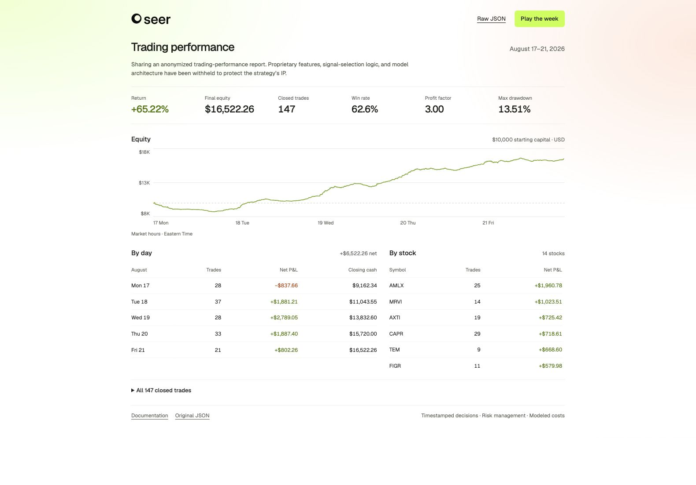

# Trading-performance report

Sharing an anonymized trading-performance report (Aug 17–21, 2026). Proprietary features, signal-selection logic, and model architecture have been withheld to protect the strategy's IP.

**Performance ($10K starting capital):**

- Return: **+65.22%** ($16,522.26 final equity)
- Closed trades: 147 | Win rate: 62.6%
- Profit factor: 3.00
- Max drawdown: 13.51%

The report includes timestamped decisions, trade execution logic, risk management, and modeled transaction costs.

[Raw JSON](data/seer-anonymized.json) · [Readable report](index.html) · [Weekly replay](replay.html) · [Documentation](docs/README.md)



## Daily results

| Date | Closed trades | Net P&L | Closing cash |
| --- | ---: | ---: | ---: |
| 2026-08-17 | 28 | −$837.66 | $9,162.34 |
| 2026-08-18 | 37 | +$1,881.21 | $11,043.55 |
| 2026-08-19 | 28 | +$2,789.05 | $13,832.60 |
| 2026-08-20 | 33 | +$1,887.40 | $15,720.00 |
| 2026-08-21 | 21 | +$802.26 | $16,522.26 |

## Open the report

Download or clone this repository, then open **`index.html`** in your browser. Use **Play the week** for the interactive replay. The HTML links above show source code on GitHub; the downloaded files run locally without installation.

```sh
git clone https://github.com/tradeseer/seer.git
cd seer
```

The raw JSON is unchanged. Its checksum is in [`data/SHA256SUMS`](data/SHA256SUMS). The readable report and replay are derived views; the proprietary strategy is not included.
